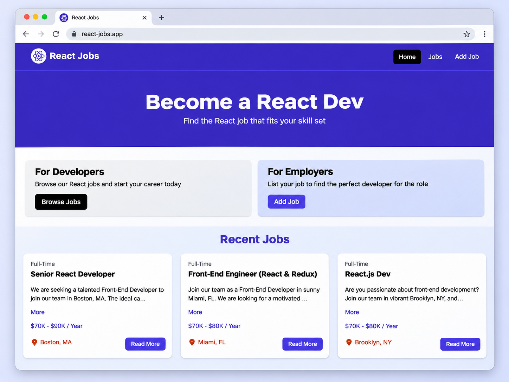
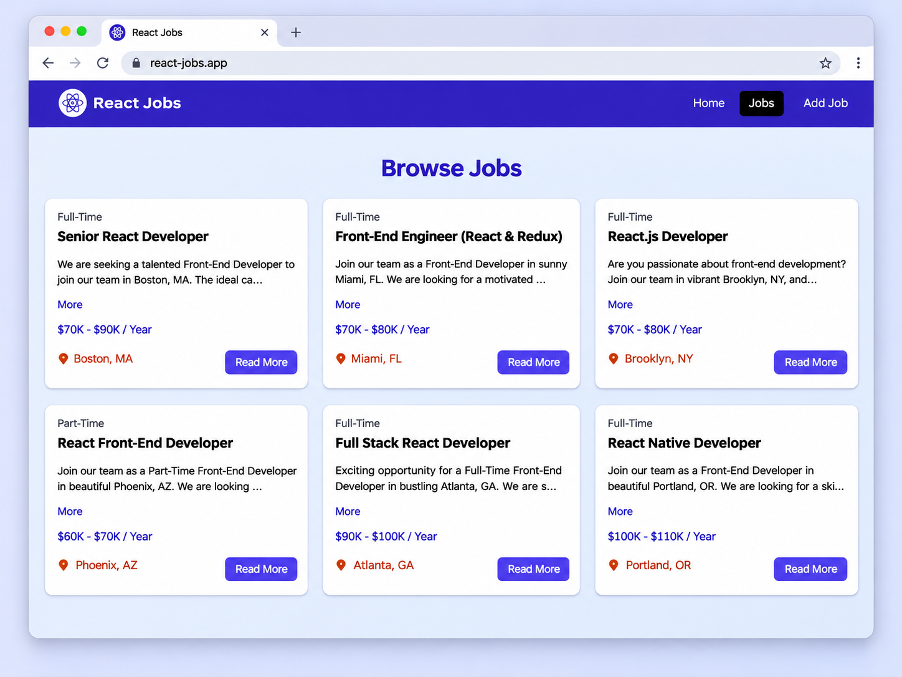
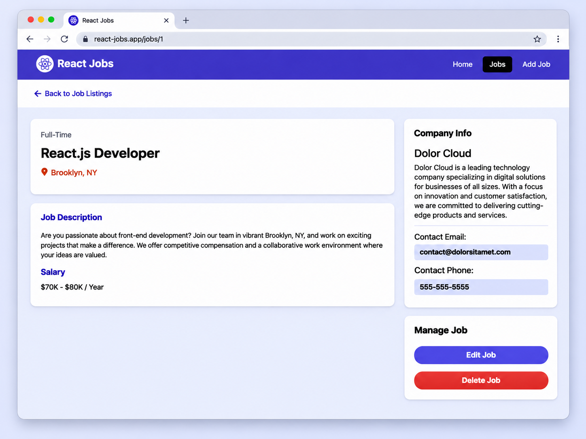
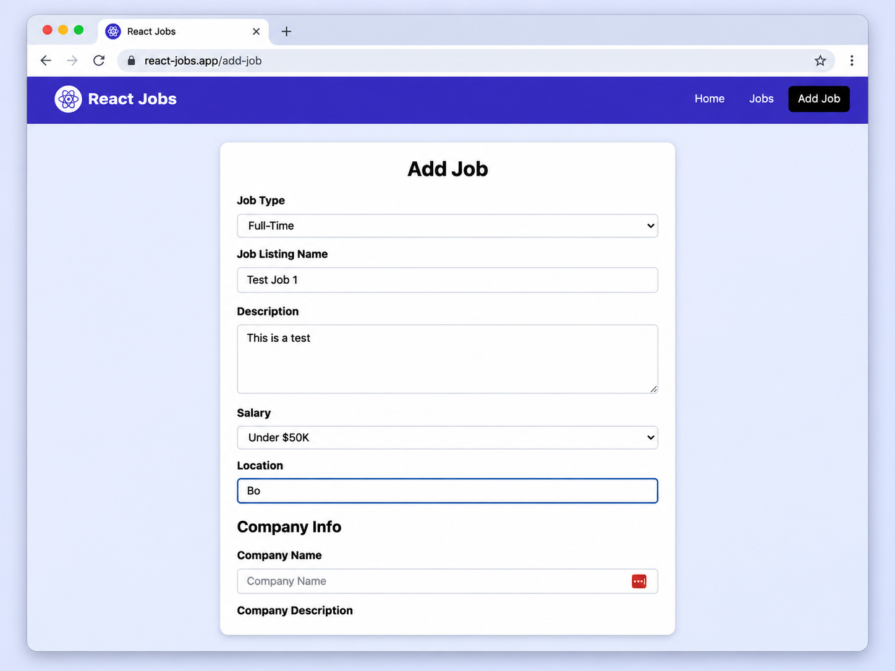

# React Jobs Webpage

A React job board web application for browsing, viewing, and creating job listings.

This project demonstrates core React concepts including components, props, state, routing, loaders, and form handling, while presenting a clean UI for developers and employers.

## Features

- Browse recent and full job listings
- View individual job details
- Add new jobs through a form page
- Edit and delete existing job listings
- Clean multi-page navigation with React Router
- Toast notifications for user actions
- Responsive card-based layout

## Tech Stack

- **React**
- **Vite**
- **React Router DOM**
- **React Toastify**
- **CSS / custom styling**
- **JSON Server** for mock backend data

## Screenshots

### Home



### Browse Jobs



### Job Details



### Add Job



## Pages / Routes

- `/` — Home page
- `/jobs` — Browse all jobs
- `/jobs/:id` — Single job details page
- `/add-job` — Add a new job

## Getting Started

### 1. Clone the repository

```bash
git clone https://github.com/rashedabuodeh/React-Jobs-Webpage.git
cd React-Jobs-Webpage
```

### 2. Install dependencies

```bash
npm install
```

### 3. Start the React app

```bash
npm run dev
```

### 4. Start the mock backend (if used in your project)

```bash
npm run server
```

If your project uses a different script for the backend, replace it with the correct one from `package.json`.

## What This Project Highlights

This project shows:

- React component structure
- Client-side routing
- CRUD-style workflow
- Form handling
- Reusable UI patterns
- Practical front-end project organization

## Acknowledgment

Based on Brad Traversy’s React crash course project and adapted as a personal learning project.
